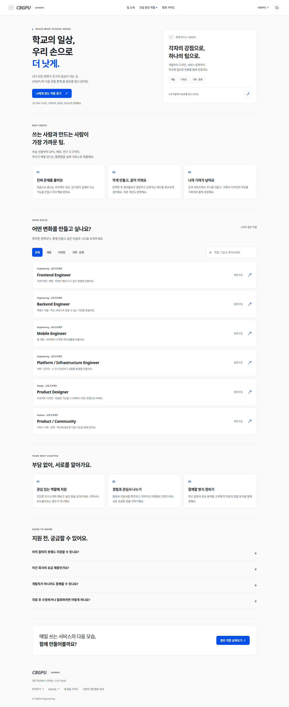
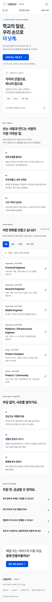
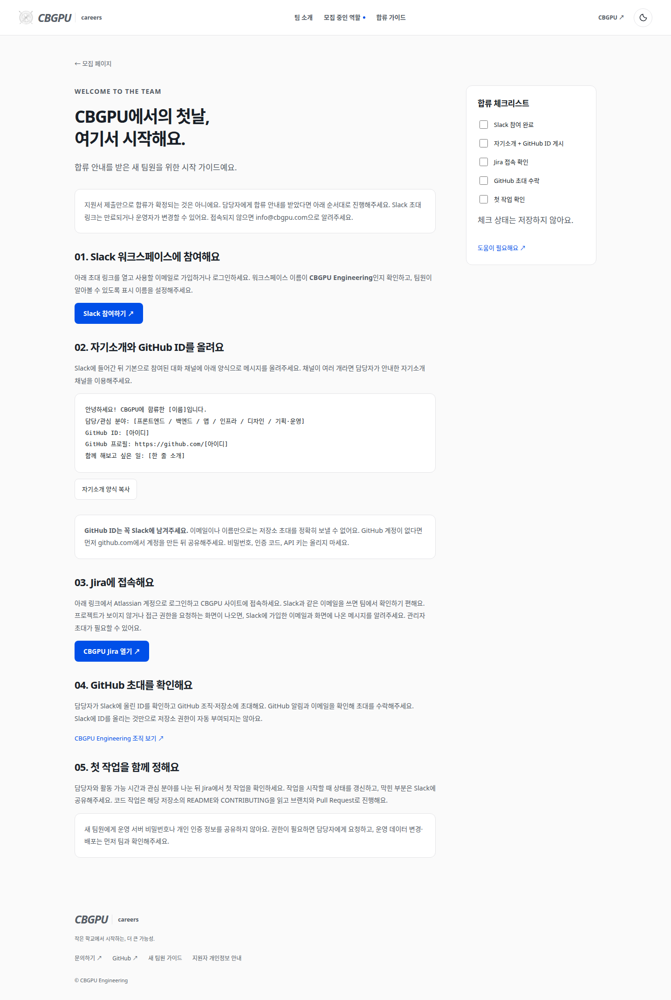
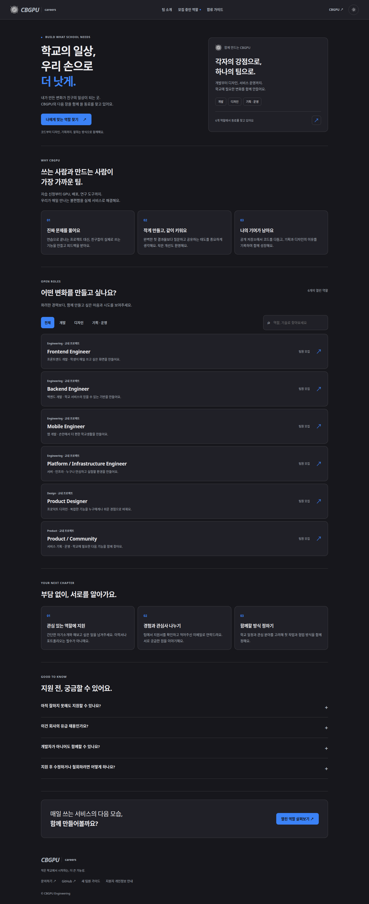

# CBGPU Careers

Recruitment and team onboarding for CBGPU at **https://careers.cbgpu.com**.
Six role descriptions, category/search filters, application forms, private SQLite
storage, and a Slack / Jira / GitHub onboarding guide. This recruits school project
contributors; it does not promise employment, pay, acceptance, or a response deadline.



<details><summary>Mobile and onboarding screenshots</summary>





</details>

## Run

Python 3.11+; no third-party packages.

```bash
export CAREERS_STATE_DIR=/path/to/private/careers
export CAREERS_ORIGIN=https://careers.cbgpu.com
# Optional: existing private backend .env containing the Resend SMTP_PASS key.
export CAREERS_MAIL_ENV=/path/to/private/backend/.env
python3 careers/server.py --port 3530
```

Listen on loopback behind an HTTPS tunnel. Keep `CF-Connecting-IP` trusted only
from the Cloudflare tunnel; this service must not be exposed directly to the network.
The database, signing key, WAL files and applicant data belong outside Git.

## Review applications

Use the authenticated developers portal terminal or SSH. Export the same
`CAREERS_STATE_DIR` as the service, then:

```bash
python3 careers/server.py --list
python3 careers/server.py --show CB-YYMMDD-REFERENCE
python3 careers/server.py --show CB-YYMMDD-REFERENCE --status contacted
python3 careers/server.py --delete CB-YYMMDD-REFERENCE
```

Review submitted links as untrusted user content. The service never fetches them.
There is deliberately no public application listing or applicant search endpoint.
Application bodies are not logged. Save the reference when requesting changes.

## Privacy and delivery

Applicants explicitly consent to 90-day retention; expired applications are deleted
by the minute maintenance worker, including when notification credentials are absent.
Private filesystem permissions, same-origin writes, signed expiring form tokens,
idempotent submission, request size/field bounds, a honeypot and persistent per-IP
rate limits protect reception. Hashed IP counters expire after 24 hours.
Notifications contain only role/reference and go to `info@cbgpu.com`. Delivery is
retried every minute, with a provider idempotency key; a failed email never discards
an application. `notified=1` records successful provider acceptance, not inbox delivery.

Slack/Jira links come from the team owner. Invites may expire and do not grant GitHub
organization access automatically. Onboarding requires posting a GitHub ID in Slack,
followed by the team's explicit organization invitation. Checklist state is not saved.

## Content and checks

Edit `roles.json` for role content and `public/app.js` for the joining guide. Styling
uses CBGPU assets and original copy. Toss recruiting information architecture was
referenced, without reusing its branding, assets or job descriptions.

```bash
python3 -m unittest discover -s careers -p 'test_*.py'
node --check careers/public/app.js
```

Apache-2.0, as the enclosing backend repository.

## Publish the hostname

Add a published application route to the existing Cloudflare Tunnel:
`careers.cbgpu.com` → `http://127.0.0.1:3530`, with the Path field empty.
Public TLS terminates at Cloudflare; the origin is loopback HTTP.
`scripts/route-careers.py --apply` performs the same additive change when
the existing Cloudflare routing authentication is valid. It checks for DNS
conflicts and snapshots the tunnel before making changes.

The joining guide is an independent server-rendered page at `/onboarding`;
it does not need the role API or application JavaScript to display its content.
Edit `public/onboarding.html` for this dedicated page and keep the in-app guide
in `public/app.js` in sync. `onboarding.js` only adds clipboard behavior.

For unattended routing, save a scoped API token (Account → Cloudflare Tunnel →
Edit and Zone → DNS → Edit, limited to the CBGPU account/zone) in
`/home/cbgpu/.config/cbgpu/cloudflare-routing-token`, permissions `600`.
The route script prefers that credential over an interactive dashboard session.
Never put the token in source files or chat. An alternative token path can be
passed through `CBGPU_CLOUDFLARE_ROUTING_TOKEN_FILE`.

## Shared public-site appearance

Recruitment, job details, application forms and the standalone joining guide use
CBGPU main-site light/dark colors from `src/app/globals.css`, the system font
stack, grayscale logo, italic wordmark, neutral bordered cards and primary button
conventions. The header theme toggle follows the main site's `theme` storage key
and system default. Preferences persist within this origin; localStorage is not
shared between subdomains. No separate font service is needed.


